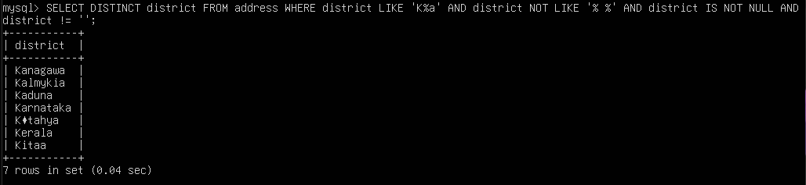
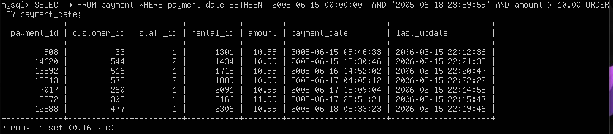
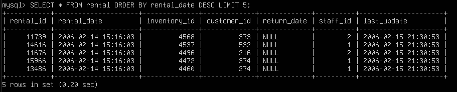
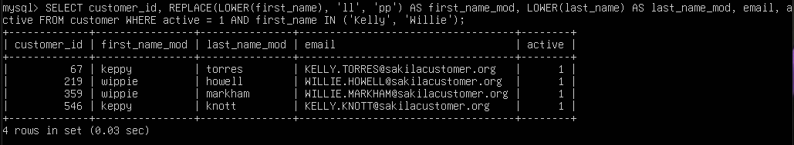

# [Задание](https://github.com/milanetology/sdb-homeworks/blob/ae2df87b6f800e80a17c6e24a4de55780cebbee9/12-03.md) к занятию "`SQL. Часть 1`"

---

### Задание 1

---

### Задание 2

---

### Задание 3

---

### Задание 4

